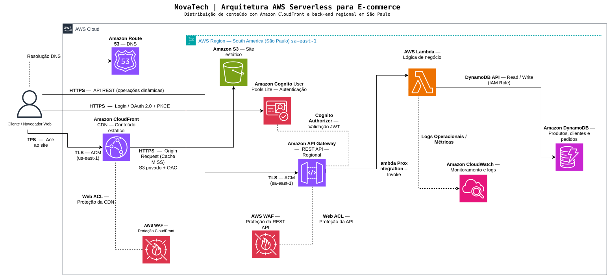

# Nova Tech — Documentação da Arquitetura AWS

## 1. Visão geral

A Nova Tech é um estudo de arquitetura para uma plataforma fictícia de e-commerce, utilizando serviços gerenciados e serverless da Amazon Web Services (AWS).

A solução separa a entrega de conteúdo estático do processamento das operações dinâmicas, permitindo que cada responsabilidade seja atendida por serviços apropriados.

A arquitetura foi planejada com os seguintes objetivos:

- Distribuir conteúdo estático por meio de uma CDN.
- Manter a origem S3 privada.
- Expor operações de negócio por uma API REST.
- Autenticar clientes e proteger operações restritas.
- Utilizar persistência gerenciada para produtos, clientes e pedidos.
- Implementar controles de segurança em diferentes camadas.
- Permitir observabilidade e acompanhamento financeiro.
- Minimizar a administração de infraestrutura.

A região principal escolhida é **South America (São Paulo), `sa-east-1`**, considerando a concentração estimada de usuários brasileiros.

O projeto possui caráter conceitual. Nenhuma infraestrutura foi provisionada para validar os fluxos em produção.

## 2. Diagrama de arquitetura

O diagrama foi desenvolvido no draw.io e representa os serviços, seus escopos geográficos e as principais integrações.

[Consultar arquivo editável da arquitetura](../diagrams/architecture.drawio)

## 3. Organização geográfica

A arquitetura distingue serviços globais de recursos implantados em uma região AWS.

### Serviços globais

**Amazon Route 53**

Responsável pela resolução DNS dos domínios da aplicação.

A proposta considera dois endpoints:

- `www.novatech.com.br` — interface web distribuída pelo CloudFront.
- `api.novatech.com.br` — API REST Regional.

Os endereços são ilustrativos e não representam domínios registrados ou configurados.

**Amazon CloudFront**

Responsável pela distribuição de arquivos estáticos por uma rede global de pontos de presença (*edge locations*).

O CloudFront atende requisições a partir do cache quando possível e consulta a origem S3 quando necessário.

**AWS WAF — escopo CloudFront**

Uma Web ACL global é associada à distribuição CloudFront para inspecionar e filtrar requisições conforme as regras configuradas.

### Recursos regionais — São Paulo (`sa-east-1`)

- Amazon S3.
- Amazon API Gateway REST Regional.
- AWS Lambda.
- Amazon DynamoDB.
- Amazon Cognito User Pools.
- Amazon CloudWatch.
- AWS WAF Regional.

A arquitetura não utiliza VPC própria, instâncias EC2, NAT Gateway ou Application Load Balancer. A ausência desses componentes decorre das necessidades identificadas para este cenário e não representa uma regra universal para aplicações serverless.

## 4. Distribuição de conteúdo estático

O frontend é composto por arquivos estáticos armazenados em um bucket Amazon S3 privado.

O CloudFront atua como camada de distribuição para os usuários.

### Fluxo de acesso

1. O navegador consulta o DNS para resolver o domínio do site.
2. Após a resolução, estabelece uma conexão HTTPS com o CloudFront.
3. O AWS WAF associado à distribuição inspeciona as requisições abrangidas pelas regras configuradas.
4. O CloudFront verifica se o conteúdo pode ser atendido pelo cache.
5. Em caso de cache HIT, o conteúdo pode ser entregue sem consultar o S3.
6. Em caso de cache MISS, o CloudFront solicita o objeto à origem.
7. A resposta é entregue ao usuário e pode ser armazenada em cache conforme as políticas configuradas.

### Proteção da origem

O bucket S3 não deve permitir leitura pública direta.

O acesso do CloudFront ao bucket utiliza **Origin Access Control (OAC)** e uma política de bucket que autoriza a distribuição correspondente.

Essa configuração evita expor o bucket como uma origem pública e mantém a distribuição de conteúdo sob controle do CloudFront.

### Considerações de cache

As políticas de cache devem considerar a natureza dos arquivos publicados.

Arquivos versionados podem utilizar períodos maiores de cache, enquanto arquivos que precisam refletir atualizações frequentes exigem políticas compatíveis com essa necessidade.

O comportamento definitivo dependeria da implementação do frontend e da estratégia de publicação adotada.

## 5. API e processamento dinâmico

As operações dinâmicas são processadas separadamente da entrega de conteúdo estático.

O navegador acessa a API pelo domínio ilustrativo `api.novatech.com.br`, diretamente no Amazon API Gateway REST Regional.

O tráfego da API não precisa passar pelo CloudFront utilizado para distribuir o frontend.

### Amazon API Gateway

Responsável por receber requisições HTTPS, aplicar as configurações da API e encaminhar as operações ao serviço de processamento.

A proposta considera uma REST API Regional, com integração à AWS Lambda.

### AWS Lambda

Responsável pela execução das regras de negócio.

Entre as responsabilidades previstas estão:

- Consulta ao catálogo de produtos.
- Consulta por categoria.
- Registro de pedidos.
- Consulta de pedidos de clientes autenticados.
- Verificações de autorização.
- Validações necessárias à integridade das operações.

A arquitetura não determina, neste estudo, a implementação efetiva do código ou a organização interna das funções.

### Comunicação

Fluxo principal:

**Navegador → API Gateway → Lambda → DynamoDB**

A resposta retorna ao cliente pela integração Lambda/API Gateway.

## 6. Autenticação e autorização

### Amazon Cognito

A proposta utiliza Amazon Cognito User Pools para autenticação de clientes.

Para uma aplicação web, considera-se o fluxo OAuth 2.0 Authorization Code com PKCE como abordagem apropriada para autenticação.

Após a autenticação, o cliente poderá apresentar o token necessário para acessar operações protegidas.

### Autorizador da API

O API Gateway REST utiliza um autorizador Cognito User Pools nas rotas protegidas.

O autorizador valida os tokens de acordo com sua configuração antes de permitir a invocação da integração protegida.

### Autorização na aplicação

Autenticar um cliente não significa permitir acesso indiscriminado aos dados.

A Lambda deverá verificar as regras de autorização específicas de cada operação.

Por exemplo, ao consultar um pedido, a aplicação deverá confirmar que o pedido pertence ao cliente autenticado, utilizando informações confiáveis derivadas da identidade validada.

Essa verificação protege contra acesso indevido a registros de outros usuários.

### CORS

Como o frontend e a API utilizam origens diferentes, a configuração de CORS deverá permitir as origens e operações necessárias.

CORS controla determinados acessos feitos por navegadores, mas não substitui autenticação, autorização ou controles de segurança da API.

## 7. Persistência com DynamoDB

A proposta utiliza Amazon DynamoDB em modo On-Demand.

O modelo conceitual considera três tabelas:

| Tabela | Responsabilidade |
|---|---|
| Products | Informações dos produtos |
| Customers | Dados associados aos clientes |
| Orders | Pedidos registrados pelos clientes |

O planejamento também considera índices secundários para consultas específicas:

- `CategoryIndex` — consulta de produtos por categoria.
- `CustomerOrdersIndex` — consulta de pedidos associados a um cliente.

A definição completa das chaves, atributos e padrões de acesso será apresentada no documento de modelo de dados.

### Integridade das operações

O registro de pedidos deverá considerar:

- Validação dos dados recebidos.
- Prevenção de operações duplicadas.
- Escritas condicionais ou transacionais quando necessárias.
- Tratamento de falhas durante o processamento.

Esses mecanismos são requisitos previstos para uma implementação futura e não foram executados neste estudo.

## 8. Segurança

A proposta contempla controles de segurança em diferentes camadas.

### AWS WAF

São previstas duas Web ACLs:

- Web ACL de escopo CloudFront, associada à distribuição.
- Web ACL Regional, associada ao estágio do API Gateway REST.

As configurações planejadas incluem regras gerenciadas e controle de taxa de requisições.

O WAF não substitui os mecanismos de autenticação e autorização da aplicação.

### AWS Identity and Access Management (IAM)

A Lambda deverá utilizar uma função de execução (*execution role*) com permissões restritas aos recursos necessários.

O princípio do menor privilégio orientará a definição de ações e recursos autorizados.

Permissões IAM para acessar o DynamoDB não substituem as verificações de autorização entre clientes e pedidos.

### HTTPS e AWS Certificate Manager

A comunicação pública utiliza HTTPS.

Para domínios personalizados, a arquitetura considera certificados gerenciados pelo AWS Certificate Manager (ACM):

- CloudFront: certificado ACM em `us-east-1`.
- API Gateway Regional: certificado ACM em `sa-east-1`.

A documentação de segurança detalhará os controles e as configurações propostas.

## 9. Observabilidade

O Amazon CloudWatch será utilizado para observabilidade operacional.

A proposta considera:

- Métricas dos serviços.
- Logs de execução da Lambda.
- Alarmes para condições relevantes.
- Acompanhamento de erros e comportamento das requisições.

Os logs de aplicação deverão evitar exposição indevida de dados pessoais e informações sensíveis.

O CloudWatch oferece informações para diagnóstico e reação operacional, mas não corrige automaticamente todos os problemas identificados.

### Auditoria e custos

O planejamento também considera:

- AWS CloudTrail para histórico de eventos de gerenciamento.
- AWS Budgets para alertas relacionados ao orçamento.

Esses componentes são documentados como mecanismos de governança e não precisam aparecer como etapas do fluxo principal de negócio.

## 10. Principais fluxos de comunicação

| Origem | Destino | Finalidade |
|---|---|---|
| Navegador | Route 53, via resolução DNS | Resolução dos domínios |
| Navegador | CloudFront | Acesso HTTPS ao frontend |
| CloudFront | S3 | Busca de objetos na origem, quando necessária |
| Navegador | Cognito | Autenticação |
| Navegador | API Gateway | Requisições às operações dinâmicas |
| API Gateway | Cognito User Pools Authorizer | Validação da autenticação em rotas protegidas |
| API Gateway | Lambda | Invocação do processamento |
| Lambda | DynamoDB | Leitura e gravação de dados |
| Lambda | CloudWatch Logs | Envio de logs operacionais |

As associações de AWS WAF aos recursos protegidos e as permissões IAM são relações de configuração e segurança, não etapas independentes de encaminhamento de todas as requisições.

## 11. Custos e dimensionamento

A arquitetura foi planejada considerando um orçamento máximo de US$ 500 por mês e uma meta de até US$ 400 mensais.

A simulação inicial registrada na AWS Pricing Calculator apresentou US$ 85,49 por mês.

O resultado é preliminar e possui ressalvas, principalmente quanto à cobertura do tráfego internacional, às franquias gratuitas e a possíveis custos complementares.

A estimativa não representa medição real de uma infraestrutura em produção.

## 12. Limitações

Esta documentação descreve uma arquitetura planejada.

Não foram realizados:

- Provisionamento dos serviços.
- Implementação de código de aplicação.
- Testes reais de integração.
- Testes de carga.
- Medições de latência.
- Validação de disponibilidade ponta a ponta.
- Verificação de custos operacionais reais.

A documentação registra decisões e hipóteses técnicas, mas não comprova o comportamento da solução em produção.

## 13. Documentação relacionada

- [README principal](../README.md)
- [Requisitos e premissas](requirements.md)
- [Diagrama editável](../diagrams/architecture.drawio)
- [Estimativa visual de custos](../assets/cost-estimation.png)

---

**Nova Tech — Estudo de arquitetura AWS para aprofundamento técnico e portfólio profissional.**