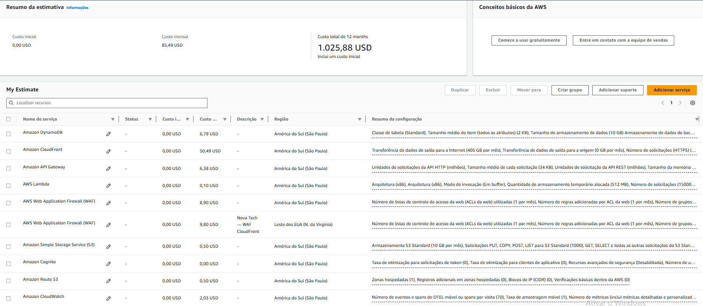

# Nova Tech — Estimativa de Custos AWS

## 1. Objetivo

Este documento apresenta o dimensionamento e a estimativa financeira da arquitetura conceitual Nova Tech, desenvolvida com foco em distribuição de conteúdo por CDN, segurança e eficiência de custos na AWS.

A simulação foi realizada na AWS Pricing Calculator com base nas premissas do projeto.

**Importante:** os valores representam uma estimativa de planejamento, não custos medidos em uma infraestrutura provisionada.

## 2. Premissas de tráfego

Para dimensionar a distribuição de conteúdo, foram consideradas as seguintes hipóteses:

| Indicador | Valor |
|---|---:|
| Visitantes únicos mensais | 30.000 |
| Visitas médias por visitante | 5 |
| Visitas mensais | 150.000 |
| Conteúdo estático por visita | 3 MB |
| Requisições estáticas por visita | 20 |
| Requisições à API por visita | 10 |
| Público no Brasil/América do Sul | 90% |
| Público internacional | 10% |

### Volume estimado

**Transferência de dados da CDN:**

150.000 visitas × 3 MB = **450 GB/mês**.

**Requisições ao CloudFront:**

150.000 visitas × 20 requisições = **3.000.000 requisições/mês**.

**Requisições à API:**

150.000 visitas × 10 requisições = **1.500.000 requisições/mês**.

Esses números são hipóteses de dimensionamento, não métricas reais.

O volume de transferência corresponde à estimativa de conteúdo estático entregue aos usuários e não representa diretamente o tráfego entre CloudFront e S3.

## 3. Distribuição geográfica

A proposta considera:

| Localização | Transferência | Requisições estáticas |
|---|---:|---:|
| Brasil/América do Sul — 90% | 405 GB | 2.700.000 |
| Demais localidades — 10% | 45 GB | 300.000 |
| **Total** | **450 GB** | **3.000.000** |

O CloudFront foi escolhido para distribuir conteúdo por meio de sua rede global de pontos de presença.

O custo pode variar conforme a localização geográfica dos usuários, o volume efetivamente transferido, as requisições e as condições comerciais aplicáveis.

## 4. Estimativa registrada na AWS Pricing Calculator

A simulação inicial apresentou:

| Indicador | Valor |
|---|---:|
| Custo inicial | US$ 0,00 |
| Custo mensal | US$ 85,49 |
| Projeção anual | US$ 1.025,88 |
| Orçamento mensal máximo | US$ 500,00 |
| Meta de planejamento mensal | US$ 400,00 |

### Captura da simulação

A imagem registra a configuração financeira utilizada durante o estudo.

## 5. Composição dos custos

| Serviço AWS | Estimativa mensal |
|---|---:|
| Amazon CloudFront | US$ 50,49 |
| AWS WAF — CloudFront | US$ 9,80 |
| AWS WAF — API Gateway | US$ 8,90 |
| Amazon DynamoDB | US$ 6,79 |
| Amazon API Gateway | US$ 6,38 |
| Amazon CloudWatch | US$ 2,03 |
| Amazon S3 | US$ 0,50 |
| Amazon Route 53 | US$ 0,50 |
| AWS Lambda | US$ 0,10 |
| Amazon Cognito | US$ 0,00 |
| **Total registrado** | **US$ 85,49** |

O CloudFront representa aproximadamente 59% do valor mensal da simulação, sendo o principal componente de custo registrado.

Os valores refletem as configurações consideradas na calculadora e não constituem uma cotação contratual.

## 6. Ressalvas da estimativa

### 6.1 Cobertura geográfica do CloudFront

A configuração registrada para o CloudFront considerou 405 GB de transferência e 2,7 milhões de requisições associados ao tráfego da América do Sul.

O planejamento completo prevê 450 GB e 3 milhões de requisições mensais.

Portanto, a parcela internacional de 45 GB e 300 mil requisições ainda precisa ser incorporada para uma estimativa global completa.

### 6.2 Franquias gratuitas

A simulação combina configurações que podem estar sujeitas a diferentes benefícios e franquias gratuitas.

É necessário verificar a elegibilidade, os limites e as regras de aplicação desses benefícios antes de interpretar o total como uma projeção final.

A estimativa registrada para o CloudFront não representa uma validação completa de todas as franquias eventualmente aplicáveis.

### 6.3 AWS WAF

A proteção foi planejada com duas Web ACLs:

- Uma de escopo CloudFront.
- Uma Regional associada ao API Gateway REST em São Paulo.

O valor de US$ 9,80 para o WAF do CloudFront foi registrado usando Norte da Virgínia como referência na calculadora.

Essa referência não significa que todo o tráfego da CDN será processado exclusivamente nessa região.

A precificação efetiva precisa ser validada conforme o escopo das Web ACLs, os grupos de regras, as requisições e os recursos de cobrança aplicáveis.

### 6.4 Custos complementares

Uma implantação real poderia apresentar cobranças adicionais relacionadas a:

- Transferência de dados e requisições não contempladas integralmente na simulação.
- Requisições à origem S3.
- Logs, métricas e retenção efetivamente utilizados.
- Mensagens de autenticação, quando aplicáveis.
- Consultas DNS e outros consumos superiores às premissas.
- Tributação e condições comerciais aplicáveis.

Não foram calculados valores adicionais sem uma configuração ou premissa que permita fundamentá-los.

## 7. Orçamento e acompanhamento financeiro

A Nova Tech possui um limite mensal de planejamento de **US$ 500**, com meta de até **US$ 400**.

A estimativa registrada corresponde a aproximadamente **17,1% do limite mensal**.

A diferença de US$ 414,51 entre o limite e a simulação é apenas uma margem teórica baseada no valor parcial registrado, e não uma economia comprovada.

### Alertas planejados

| Percentual do orçamento | Valor |
|---|---:|
| 50% | US$ 250 |
| 80% | US$ 400 |
| 100% | US$ 500 |

O AWS Budgets foi considerado para acompanhamento e emissão de alertas.

Alertas de orçamento não impedem automaticamente a cobrança de recursos.

## 8. Considerações sobre o cache

O CloudFront pode reduzir a quantidade de requisições direcionadas ao S3 por meio do armazenamento temporário dos objetos em cache.

Em um **cache HIT**, o CloudFront atende a requisição utilizando um objeto armazenado em cache.

Em um **cache MISS**, o CloudFront precisa consultar a origem ou outra camada apropriada de cache para obter o conteúdo.

A taxa de acertos de cache influencia a carga sobre a origem e pode afetar custos operacionais.

Entretanto, não foi definida ou medida uma taxa de cache HIT para a Nova Tech.

Por isso, não atribuímos uma economia financeira específica ao uso do cache.

## 9. Limitações

A estimativa apresenta limitações importantes:

- Não representa consumo real.
- Não foi validada por testes de carga.
- Não contempla integralmente o tráfego internacional da CDN.
- Pode depender de franquias gratuitas e condições comerciais específicas.
- Não estabelece uma taxa de cache HIT.
- Não comprova o atendimento definitivo ao orçamento.
- Está sujeita a alterações de preços e de consumo.

A análise deve ser entendida como um exercício de dimensionamento e planejamento financeiro.

## 10. Conclusão

A AWS Pricing Calculator permitiu relacionar premissas de tráfego aos principais componentes financeiros da arquitetura Nova Tech.

O CloudFront se destacou como o principal custo registrado na simulação, reforçando a importância de compreender distribuição geográfica, transferência de dados, requisições e comportamento do cache.

A estimativa mensal inicial de US$ 85,49 indica um cenário potencialmente compatível com o orçamento, mas ainda exige validação antes de ser utilizada como previsão operacional definitiva.

O objetivo do estudo é demonstrar raciocínio arquitetural e consciência financeira, sem apresentar resultados simulados como medições de produção.

## 11. Referências

- [AWS Pricing Calculator](https://calculator.aws/)
- [Amazon CloudFront Pricing](https://aws.amazon.com/cloudfront/pricing/)
- [Amazon S3 Pricing](https://aws.amazon.com/s3/pricing/)
- [AWS WAF Pricing](https://aws.amazon.com/waf/pricing/)
- [AWS Budgets](https://aws.amazon.com/aws-cost-management/aws-budgets/)

---

Nova Tech — Estudo individual de arquitetura AWS para aprendizado e portfólio profissional.